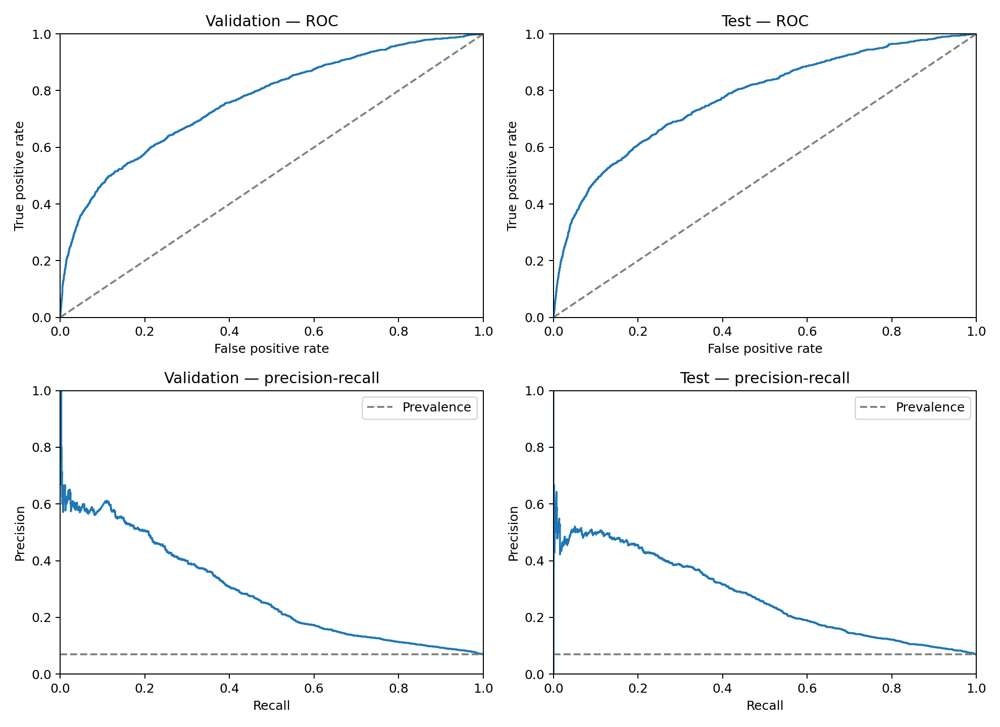
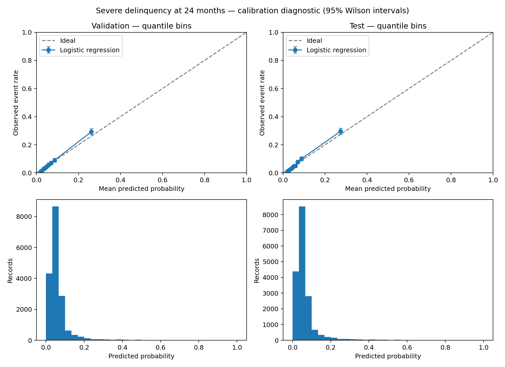
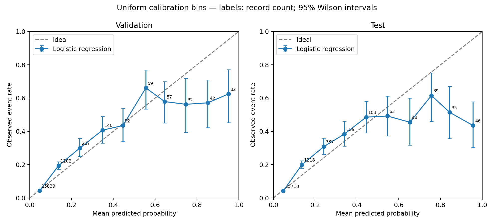

# Resultado del baseline GMSC

Modelo: **gmsc-logreg-v1**. Objetivo: **probabilidad estimada de morosidad grave a 24 meses**.

## Dataset y preparación

Fuente original: [Give Me Some Credit](https://www.kaggle.com/competitions/GiveMeSomeCredit).
Copia versionada: [OpenML 45577, versión 1](https://www.openml.org/api/v1/json/data/45577).
SHA-256 del archivo: `1d1a66d10042a3ff8ed4f7712f52c2701ccef1924509cc11420188f512af327a`.

- Originales: 150,000; positivos: 10,026 (6.6840%).
- Utilizados: 118,412; positivos: 8,208 (6.9317%).
- Excluidos: 31,588. Los motivos siguientes son secuenciales y no se superponen.

| Motivo | Registros |
|---|---:|
| invalid_target | 0 |
| missing_or_nonpositive_income | 31,365 |
| invalid_or_underage_age | 1 |
| invalid_debt_ratio | 0 |
| missing_negative_or_fractional_late_count | 0 |
| anomalous_late_codes_96_98 | 141 |
| exact_duplicate_raw_record | 81 |

Los códigos 96/98 se excluyeron como extremos recurrentes; su significado como faltante no está confirmado. No se recodificaron como cero.
Los duplicados se identificaron por igualdad de toda la fila original, no solamente por las cuatro variables seleccionadas.

## Variables y entrenamiento

- `age`
- `DebtRatio`
- `NumberOfTime30-59DaysPastDueNotWorse`
- `NumberOfTime60-89DaysPastDueNotWorse`

Pipeline: log1p del ratio, imputación mediana, escalado y Regresión Logística L2.
Imputación y escalado ajustados solo con entrenamiento. Tras los filtros no hay faltantes en las cuatro entradas.
C elegido: **0.1**, por menor log loss de validación entre 0.1, 1 y 10.
La diferencia entre candidatos es mínima; no implica una mejora sustancial demostrada.
Sin SMOTE, balanceo de clases, recalibración ni ajuste posterior al observar prueba.
El artefacto conserva el ajuste sobre entrenamiento: no fue reentrenado con validación ni prueba.

| Partición | Registros | Positivos | Proporción |
|---|---:|---:|---:|
| train | 82,888 | 5,746 | 6.9322% |
| validation | 17,762 | 1,231 | 6.9305% |
| test | 17,762 | 1,231 | 6.9305% |

Semilla 42; partición aleatoria estratificada 70/15/15. No es validación temporal.

## Métricas

| Métrica | Validación | Prueba |
|---|---:|---:|
| roc_auc | 0.765057 | 0.775013 |
| average_precision | 0.289259 | 0.273895 |
| brier_score | 0.057123 | 0.058152 |
| log_loss | 0.216286 | 0.218583 |

Comparación constante: probabilidad fija igual a la tasa positiva de entrenamiento.

| Métrica constante | Validación | Prueba |
|---|---:|---:|
| roc_auc | 0.500000 | 0.500000 |
| average_precision | 0.069305 | 0.069305 |
| brier_score | 0.064502 | 0.064502 |
| log_loss | 0.251838 | 0.251838 |

### Diagnóstico por umbral

Estos umbrales son diagnósticos de clasificación, no decisiones de aprobación/rechazo ni niveles integrados en C#.

| Partición | Umbral | Precision | Recall | F1 | Matriz [[TN, FP], [FN, TP]] |
|---|---:|---:|---:|---:|---|
| validation | 0.1 | 0.282891 | 0.441917 | 0.344959 | [[15152, 1379], [687, 544]] |
| validation | 0.25 | 0.483456 | 0.213647 | 0.296338 | [[16250, 281], [968, 263]] |
| validation | 0.5 | 0.603604 | 0.108855 | 0.184446 | [[16443, 88], [1097, 134]] |
| test | 0.1 | 0.279354 | 0.463851 | 0.348702 | [[15058, 1473], [660, 571]] |
| test | 0.25 | 0.428339 | 0.213647 | 0.285095 | [[16180, 351], [968, 263]] |
| test | 0.5 | 0.497797 | 0.091795 | 0.155007 | [[16417, 114], [1118, 113]] |

## Calibración

| Diagnóstico | Validación | Prueba |
|---|---:|---:|
| observed_positive_rate | 0.069305 | 0.069305 |
| mean_predicted_probability | 0.069217 | 0.070817 |
| ece_quantile_bins | 0.007337 | 0.009889 |
| diagnostic_calibration_intercept | 0.038452 | -0.148115 |
| diagnostic_calibration_slope | 1.015437 | 0.948742 |

El promedio está próximo a la prevalencia y el diagnóstico global de pendiente se aproxima a 1.
**Esto no demuestra calibración uniforme:** los intervalos medios subestiman eventos y la cola alta los sobreestima.
En prueba, el intervalo (0.9, 1.0] tiene 46 casos: probabilidad media 95.58% frente a 43.48% observado (IC Wilson 95%: 30.21%–57.75%).
Los deciles agrupan gran parte de la cola alta en un solo intervalo y pueden ocultar ese problema.
ECE depende de los intervalos y no garantiza calibración local. Brier y log loss también reflejan discriminación.
Intercepto y pendiente son ajustes diagnósticos sobre cada holdout, no un calibrador aplicado al modelo.

## Limitaciones

- Dataset histórico externo; no valida probabilidades para Argentina actual.
- No permite seleccionar exclusivamente empleados en relación de dependencia.
- La población se restringe a ingreso conocido positivo y excluye registros anómalos/duplicados; puede producir sesgo de selección.
- Códigos de mora 96/98 excluidos como extremos recurrentes, sin afirmar una semántica de faltante confirmada.
- Sin fecha de observación ni ID de persona para separación temporal o por solicitante.
- Historial de mora declarado solo para la futura demostración académica; en un entorno real requiere fuentes crediticias externas.
- Monto, plazo y antigüedad no influyen en este baseline.
- Las bandas de riesgo serán reglas configurables de C#, no decisiones automáticas.
- DebtRatio conserva valores extremos incluso tras filtrar ingresos positivos (máximo 61.106,5); log1p atenúa su escala, pero no certifica la calidad del dato.
- Edad observada elegible: 21–103 años. No demuestra desempeño en solicitantes de 18–20 años ni garantiza población laboral activa.
- No se cambió el baseline tras observar las métricas de prueba; futuras mejoras requieren una nueva evaluación independiente.

## Artefactos

- `../artifacts/model.joblib`: pipeline completo; recarga verificada con probabilidades idénticas.
- `../artifacts/metadata.json`: versión, objetivo, variables, configuración, hashes y dependencias.
- `dataset_analysis.json`, `excluded_rows.csv` y `split_assignments.csv`: trazabilidad de preparación y particiones.
- `metrics.json`, `calibration_summary.json` y tablas de calibración: resultados completos.
- `validation_predictions.csv` y `test_predictions.csv`: probabilidades para reproducción.
- `coefficients.csv`: coeficientes sobre entradas transformadas/escaladas; no explicaciones causales.

No hay API, integración C#, OCR, almacenamiento de solicitudes ni interpretación final con IA.
